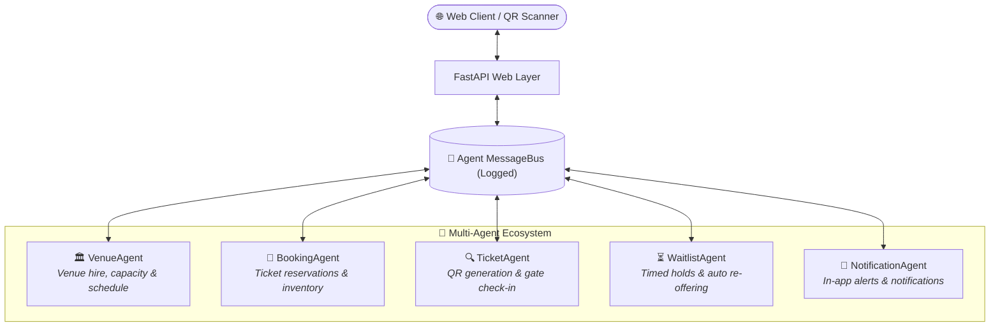

# 🎟️ Evently — Multi-Agent Venue Booking & Ticketing Platform

[](https://www.python.org/)
[](https://fastapi.tiangolo.com/)
[](https://www.sqlalchemy.org/)
[](https://getbootstrap.com/)
[](https://pytest.org/)
[](LICENSE)

> **Evently** is an enterprise-grade venue booking, event management, and ticketing platform powered by a **decentralized Multi-Agent System (MAS)**. Built with FastAPI, SQLAlchemy, and Bootstrap 5, all business logic, booking approvals, venue hire negotiations, and waitlist allocations are handled by **5 autonomous agents** communicating through standard FIPA-ACL JSON messages over a persistent message bus.

---

## 🏛️ System Architecture & Autonomous Agents

Evently decouples core domain operations into five specialized, autonomous agents. Every decision, transition, and belief state update is logged for complete auditability.



### The Agent Roster
* **🏛️ VenueAgent**: Evaluates venue hire requests, enforces buffer times, computes peak/weekend multipliers, and prevents schedule conflicts.
* **🎫 BookingAgent**: Governs ticket availability, atomic quantity deduction, basket hold validations, and purchase finalization.
* **🔍 TicketAgent**: Generates cryptographically secure ticket codes, renders QR codes, and detects duplicate or suspicious gate scans.
* **⏳ WaitlistAgent**: Manages queue allocations with a proactive 30-second scheduler sweep, releasing expired holds and notifying the next attendee in line.
* **🔔 NotificationAgent**: Listens to system-wide agent broadcasts and dispatches contextual user notifications.

---

## 🚀 How to Run Locally

### Prerequisites
* **Python 3.10+** (Python 3.11 or 3.12 recommended)
* **Git**

### Step-by-Step Setup

1. **Clone the repository and enter the project folder:**
   ```bash
   git clone https://github.com/your-username/Evently.git
   cd Evently
   ```

2. **Create and activate a virtual environment:**
   * **Linux / macOS:**
     ```bash
     python3 -m venv .venv
     source .venv/bin/activate
     ```
   * **Windows (PowerShell / CMD):**
     ```powershell
     python -m venv .venv
     .venv\Scripts\Activate.ps1
     ```

3. **Install dependencies:**
   ```bash
   pip install --upgrade pip
   pip install -r requirements.txt
   ```

4. **Configure environment variables:**
   ```bash
   # Linux / macOS
   cp .env.example .env

   # Windows (PowerShell)
   Copy-Item .env.example .env
   ```

5. **Start the development server:**
   ```bash
   uvicorn app.main:app --reload --host 127.0.0.1 --port 8000
   ```

6. **Open in browser:**
   * **Web Application:** [http://127.0.0.1:8000](http://127.0.0.1:8000)
   * **Interactive API Documentation:** [http://127.0.0.1:8000/docs](http://127.0.0.1:8000/docs)
   * **Alternative API Docs:** [http://127.0.0.1:8000/redoc](http://127.0.0.1:8000/redoc)

> 💡 **Tip:** On initial launch with `SEED_DEMO=1`, the SQLite database (`evently.db`) is automatically initialized and populated with sample venues, events, ticket categories, and demo user accounts.

---

## ⚙️ Environment Variables

Configure application settings by modifying `.env` or exporting system environment variables:

| Variable | Description | Default | Production Recommendation |
|:---|:---|:---:|:---|
| `DATABASE_URL` | SQLAlchemy connection string (SQLite or PostgreSQL) | `sqlite:///./evently.db` | PostgreSQL connection string |
| `SECRET_KEY` | Cryptographic secret for signing session cookies | `dev-only-change-me` | 64+ char random hex string |
| `APP_TIMEZONE` | Timezone for event scheduling and display | `Asia/Colombo` | Local server / target timezone |
| `HTTPS_ONLY` | Enforces `Secure` flag on HTTP cookies (`1` to enable) | `0` | Set to `1` behind SSL/TLS |
| `SEED_DEMO` | Seeds sample events, venues, and users when DB is empty | `1` | Set to `0` in production |
| `ENABLE_SCHEDULER` | Runs the proactive 30s WaitlistAgent expiration sweep | `1` | `1` (leave enabled) |
| `HOLD_MINUTES` | Duration (in minutes) for waitlist seat-reservation holds | `10` | `5` – `15` depending on traffic |
| `AGENT_API_KEY` | Secret token required for external HTTP agent inboxes | `""` *(disabled)* | Strong API secret key |

---

## 👥 Demo Accounts

The database comes pre-seeded with three role-delineated test accounts (password for each account is listed below):

| Role | Email Address | Password | Permissions & Available Features |
|:---|:---|:---:|:---|
| 👑 **Admin** | `admin@evently.test` | `Admin#12345` | • Full administrative dashboard & analytics<br/>• Create, edit, publish & cancel events<br/>• Manage venues & review venue hire applications<br/>• Trigger manual waitlist hold sweeps |
| 🛡️ **Gate Staff** | `staff@evently.test` | `Staff#12345` | • Live QR code camera scanner (`/staff/scanner`)<br/>• Manual ticket admission verification<br/>• Real-time ticket validation with audio/vibration feedback |
| 🎟️ **Attendee** | `attendee@evently.test` | `Attendee#12345` | • Browse published events with filters<br/>• Book tickets with real-time seat hold timers<br/>• Join event waitlists with automatic seat allocation<br/>• View digital tickets with dynamic QR codes<br/>• Submit venue hire requests |

---

## 🧪 How to Run the Tests

The project includes an extensive test suite verifying agent cooperation, concurrency, ticket lifecycle, and edge cases.

### Running Pytest
```bash
# Run the complete test suite with verbose output
pytest -v

# Run tests with short traceback format
pytest -v --tb=short

# Run a specific test module
pytest tests/test_agents.py -v
```

### Test Coverage Highlights
* **Agent MessageBus & Protocols:** Validates FIPA-ACL message exchanges, performative validation (`REQUEST`, `INFORM`, `AGREE`, `REFUSE`, `FAILURE`), and message logging.
* **Concurrency & Overbooking Prevention:** Stresses ticket reservations across **12 concurrent threads** to guarantee zero overselling.
* **Gate Check-in & Security:** Tests single-use ticket check-in, duplicate scan prevention, and suspicious repeated scan alarms.
* **Waitlist Lifecycle:** Tests queue priority, temporary ticket holds, automatic timeout expiry, and automatic re-offering to the next user.
* **Venue Scheduling:** Tests pricing calculations (peak hours & weekend rates), minimum buffer rules, and conflict detection.

---

## 📡 HTTP Agent Inboxes (External Agent Integration)

Evently exposes authenticated REST endpoints allowing external AI agents or services to communicate directly with internal agents via FIPA-ACL messages:

```bash
# Example: Sending a ticket verification REQUEST to TicketAgent
curl -X POST "http://127.0.0.1:8000/api/agents/TicketAgent/inbox" \
  -H "X-Agent-Key: testkey" \
  -H "Content-Type: application/json" \
  -d '{
    "sender": "external_scanner",
    "performative": "REQUEST",
    "content": {
      "action": "scan",
      "code": "TKT-DEMO-001",
      "event_id": 1
    }
  }'
```

---

## 🚢 Production Deployment (Render)

Evently includes ready-to-deploy configuration for cloud hosting on [Render](https://render.com):

1. **Deploy with Blueprint (`render.yaml`):**
   * Link your repository in Render Dashboard.
   * Click **New +** → **Blueprint** and select this repository.
   * Render automatically provisions a FastAPI Web Service and a Managed PostgreSQL database.
2. **Environment Configuration:**
   * `render.yaml` automatically injects PostgreSQL `DATABASE_URL` and auto-generates secure random values for `SECRET_KEY` and `AGENT_API_KEY`.
3. **Start Command:**
   ```bash
   uvicorn app.main:app --host 0.0.0.0 --port $PORT
   ```

---

## 📁 Project Directory Layout

```text
Evently/
├── app/
│   ├── agents/               # Autonomous agent modules
│   │   ├── base.py           # Agent base class with persistent belief states
│   │   ├── booking_agent.py  # Reservation, booking & inventory agent
│   │   ├── bus.py            # Logged JSON message bus (FIPA-ACL)
│   │   ├── messages.py       # Standard message envelope & performatives
│   │   ├── notification_agent.py # User notifications dispatcher
│   │   ├── registry.py       # Bus initialization & request dispatcher
│   │   ├── scheduler.py      # Background thread for waitlist sweep
│   │   ├── ticket_agent.py   # QR generation & check-in validation
│   │   ├── venue_agent.py    # Venue hire, pricing & calendar management
│   │   └── waitlist_agent.py # Dynamic queueing & timed seat holds
│   ├── routers/              # FastAPI route controllers
│   │   ├── admin.py          # Admin dashboard, event/venue management
│   │   ├── api.py            # External HTTP agent inboxes & health checks
│   │   ├── auth.py           # Login, registration & session termination
│   │   ├── hire.py           # Venue hire request forms & status
│   │   ├── public.py         # Event catalog, ticket purchase & waitlist
│   │   └── staff.py          # QR ticket scanner & admission verification
│   ├── static/               # Frontend CSS, JavaScript & QR libraries
│   ├── templates/            # Jinja2 templates (Public, Staff, Admin)
│   ├── config.py             # Global settings & business rule constants
│   ├── database.py           # Database engine & session maker
│   ├── main.py               # FastAPI application factory & middleware
│   ├── models.py             # SQLAlchemy ORM models & database schema
│   ├── policy.py             # Refund policy display rules
│   ├── schemas.py            # Pydantic schemas & validation
│   ├── security.py           # Password hashing, sessions, CSRF & RBAC
│   └── seed.py               # Demo database seeder
├── tests/                    # Pytest test suite & concurrency tests
├── render.yaml               # Cloud deployment blueprint for Render
├── requirements.txt          # Python dependencies
└── README.md                 # Project documentation
```

---

## 📄 License

This project is licensed under the Apache 2.0 License. See the [LICENSE](LICENSE) file for details.
